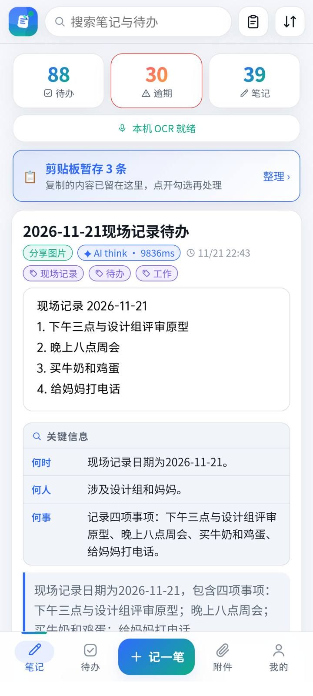
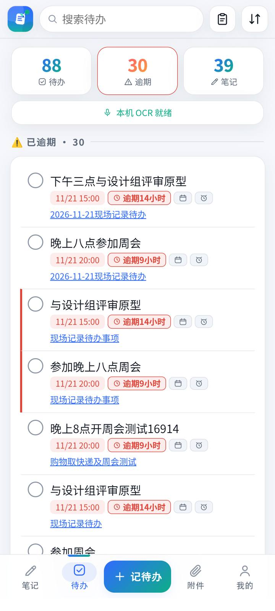
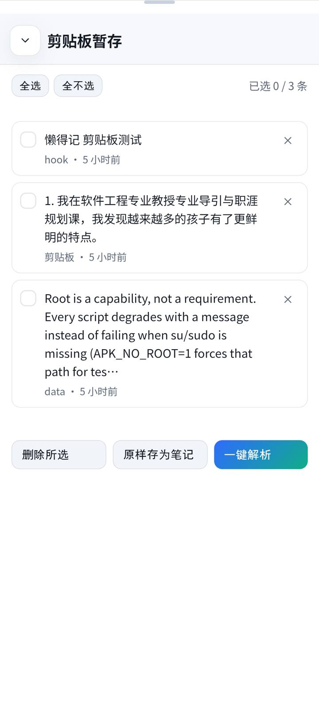
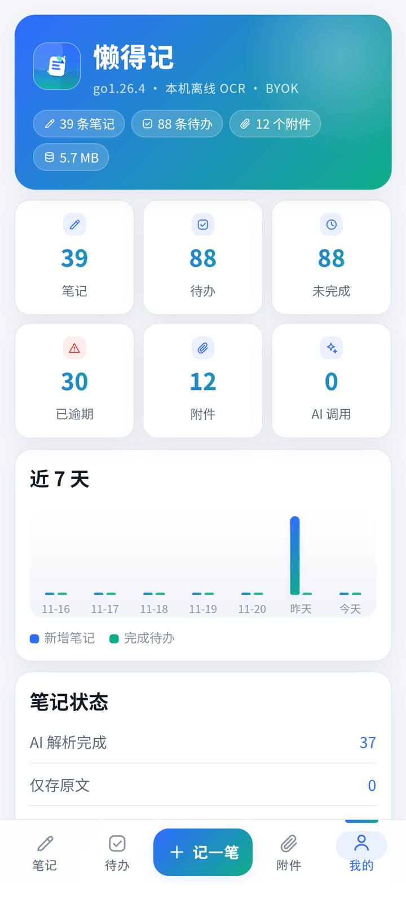
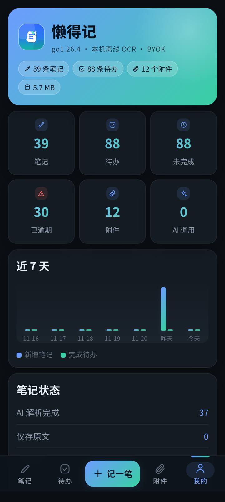
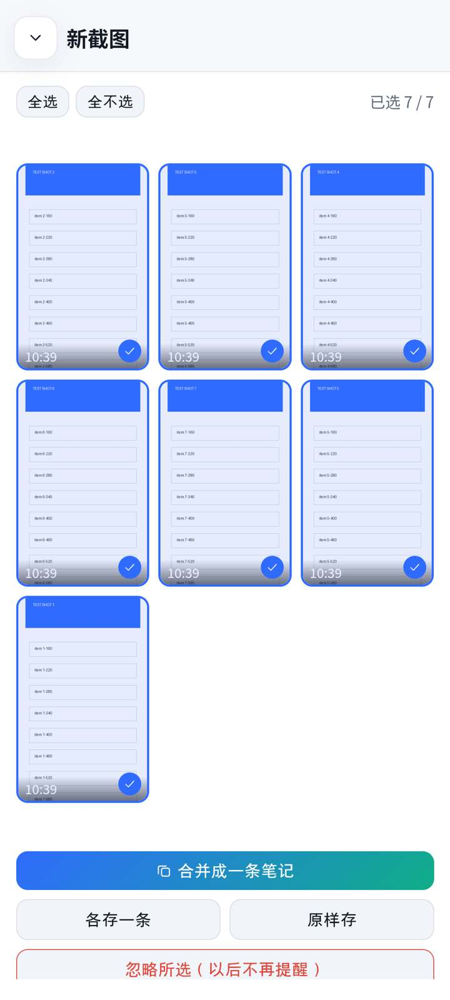
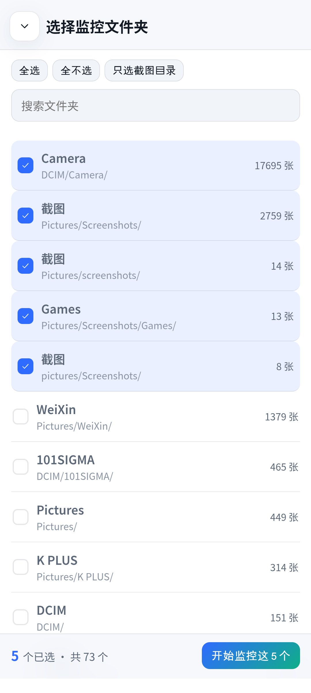
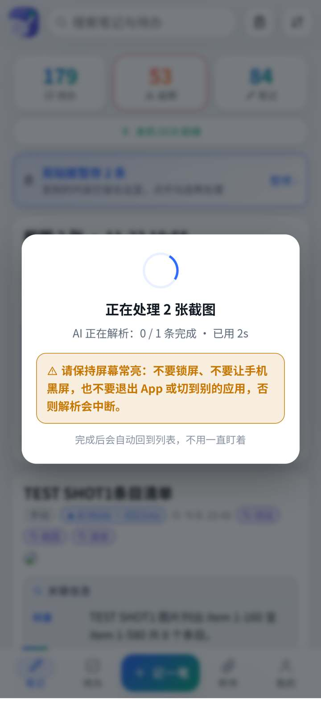

# eNote（懒得记）— 分享即笔记

一个装在 Android 手机上的笔记 + 待办：把任何文字、图片、或刚复制的剪贴板内容丢给「懒得记」，
它先在本地做 OCR，再交给自己的大模型（BYOK）整理成「标题 / 正文 / 标签 / 带截止时间的待办」。
全部构建、签名、安装、测试都在这台手机的 Termux 里完成，没有 PC、没有 Gradle、没有 Android Studio。

包名 `dev.xduo.enote`，显示名 `懒得记`，minSdk 26，targetSdk 33，arm64-v8a，APK ≈ 13.2 MB。

---

## 界面

<p>





</p>
<p>



</p>

界面是 `go/ui/` 目录（`index.html` + `css/` + `js/` + `vendor/`），由 Go 的 HTTP 服务在 `127.0.0.1` 上提供，WebView 加载。
以前是单文件 `go/ui.html`（2527 行），P13 拆成了目录，见 `plan.md` §9。
图标是一整套 24dp 线性 SVG（内嵌 sprite，随 `currentColor` 变色）；启动器图标用
用户自己的一套 PNG（5 个密度 + 自适应图层），`tools/ui_test.js` 会锁住它，
防止有人又换回矢量重绘。

---

## 1. 快速开始

```bash
cd ~/eNote
GO_TEST=1 ./build.sh      # 编译 Go（含单元测试）+ javac + d8 + aapt2 + 签名 → enote.apk
./install.sh              # pm install -g 并启动
./test.sh                 # 端到端验收测试（需要 root）
./test.sh --vd            # 同上，但跑在隐形后台屏上，手机面板归你
```

脚本都是 bash/sh，**必须写成 `./build.sh`**，不要 `sh build.sh`。
工具链（android-33 jar、签名密钥）由 `dev-apk-on-android` skill 统一维护，不在本项目里。

`app.env` 是唯一的配置入口：包名、Activity、API 级别、APK 名、Go 模块目录与 `.so` 名字。

## 2. 用法

**分享（主路径）**：任何 App 里点分享 → 选 `eNote`。

| 分享内容 | 发生什么 |
| --- | --- |
| 纯文本 / 链接 | 立刻落库为「排队中」，后台交给大模型解析 |
| 单张 / 多张图片 | 先**在本机** OCR（vivo 离线引擎），只有识别出的文字会发给大模型，图片本身从不上传 |
| 语音 / 音频 | 先**在本机**离线识别（vivo 语音引擎，93 MB 模型打进 APK），文字进库，音频原样留作附件 |

图片走 `SEND` / `SEND_MULTIPLE` / `VIEW` 三种 intent，所以相册、微信、浏览器都能分享进来。

**App 内**：底部五个入口 笔记 / 待办 / ➕记一笔 / 附件 / 我的，顶栏是搜索 + 剪贴板暂存 + 排序。

* ➕「记一笔」：面板打开即是完整形态——上面一个文本框（右下角实时显示 `字数 / 2000`），
  下面三个按钮 `🖼 选图片` / `📎 选文件` / `保存并解析`（主按钮最宽），再往下**直接就是
  语音暂存区**（不用先点「录音」再展开）。粘贴文字直接解析，选图片走本机 OCR，选文件当
  附件存下来，语音说几段攒着，最后都靠 `保存并解析` 一个按钮交出去。
* 语音区：底部大圆钮**按住说话**（松手结束本段），**点一下 = 免手持**（再点一下才结束，
  中间的思考停顿不会被切成两段），每段 ≤2 分钟。每段的识别文字进上方暂存区，可逐条编辑 /
  删除 / 回放，左键撤销上一段。**「发送」与「保存并解析」是同一个按钮**（P18.3）：有语音段时
  主按钮上直接写出段数（`保存并解析 · 3 段语音`），点一下把**打字内容 + 全部语音段合成一条
  笔记**（每段音频各挂一个附件）；没录音时它还是原来的「只存文字」。正在录音时点它，会先把
  刚说完那段收完再提交，不会丢段。卡片上还有 `重新识别语音`，拿原音频重跑一遍。
* 笔记卡片：勾选待办、展开详情、`重新解析`、`重新识别图片`、`+ 待办`、`删除`；
  AI 提取出的「关键信息」（何时 / 何人 / 何事 / 何地 / 为什么 / 备注）直接列在卡片里。
* 待办页按 已逾期 / 今天 / 明天 / 本周 / 以后 / 无日期 / 已完成 分组，红色左边框 = 高优先级，
  倒计时标签（今天 / 3 天后 / 已逾期 2 天）实时刷新，勾选完成有划线 + 淡出 + 高亮入场动画。
* 剪贴板暂存：复制过的文本自动攒着（前台采集，去重），横幅上显示条数，打开后勾选 →
  `一键解析` / `原样存为笔记` / `删除所选`。
* **截图捕获**：首次开启时选要盯的文件夹（默认勾上截图目录，可多选：相机、微信图片、
  自定义目录都行）。之后新截图自动进暂存区，首页横幅显示「发现 N 张新截图」，点开是
  3 列缩略图网格，多选后：
  * `合并成一条笔记`：N 张图 = 1 条笔记、N 个附件，OCR 文本拼接后**只调一次** AI；
  * `各存一条`：N 张图 = N 条笔记（超过 5 张会先确认，因为那是 N 次 AI 调用）；
  * `原样存`：不调 AI，直接存原文；
  * `忽略所选`：永久不再提醒。

  处理期间会弹出不可关掉的进度层，并**真的保持屏幕常亮**——文案明确写了「不要锁屏、
  不要黑屏、不要退出 App」，因为解析是在前台跑的。首次开启不会回捞历史截图（这台机器
  存了 2759 张），要看旧的用「我的 → 截图捕获 → 回捞最近 7 天」。
* 附件页：图片 / PDF / 音频 / 压缩包按类型图标展示，可预览、可转成笔记。
* 我的页：本地数据摘要（笔记 / 待办 / 附件 / 占用）、近 7 天活动柱状图、笔记状态、常见标签，
  以及设置、运行日志、AI 调用记录、导出 / 导入 JSON、清空数据。
* 设置页：API Base URL、Key、模型名、超时、max tokens、温度、`测试连接`、主题（亮 / 暗 / 跟随系统）、
  本地 OCR 引擎状态、本地语音识别引擎状态、剪贴板采集开关、常驻后台开关与电池优化引导。
  Key 明文存在 `files/enote/settings.json`，接口返回时打码成「前 4 + … + 后 4」，回传打码值不会覆盖真 Key。

在「设置 → AI 模型」选择连接方式：

- **ChatGPT 套餐**：打开系统浏览器登录并授权使用套餐用量。返回 eNote 后，从账号可用的模型中选择一个，再点「测试连接」。模型请求会发送给 OpenAI，并计入 ChatGPT 套餐用量。可在同一页面断开连接。
- **API Key**：填写 OpenAI 兼容服务的 API Base URL、Key 和模型名。模型不可用时，笔记会按原文保存，之后可以重新解析。

## 3. 架构

```
Java 壳 (src/dev/xduo/enote/)                Go 业务层 (go/, 编成 libenote.so)
  EnoteApp     启动 Go、初始化 OCR      ┌──  main.go      JNI 入口 + 生命周期
  OcrHelper    vivo 离线 OCR            │   app.go        全局状态
  SttHelper    vivo 离线语音识别        │   voice.go      语音文本后处理
  ShareActivity 接收分享 intent         │   store.go      notes.json 读写
  MainActivity WebView 容器            ├──  pipeline.go  队列 + worker + 解析
  Bridge       JNI + WebView 桥        │   llm.go        OpenAI 兼容客户端 + 调用记录
                ↑ window.Android       │   config.go     settings.json + 日志
                └──────────────────────┴──  web.go       127.0.0.1 HTTP + go/ui/ 静态服务
```

* 界面是 `go/ui/` 目录（`go:embed all:ui`），由 Go 的 HTTP 服务在 `127.0.0.1:<随机端口>` 上提供，
  WebView 加载它。静态文件全部 `no-store`（升级后不许新页面配旧脚本），Content-Type 写死在
  `go/web.go` 的 `contentType()` 里——Android 上没有 `/etc/mime.types`，靠系统探测会回落 `text/plain`，
  WebView 直接不执行脚本。UI ↔ Go 只走 HTTP，JNI 面积极小（7 个导出函数）。
* **OCR 在 Java 侧、入库前完成**：`ShareActivity` / 图片选择器 / `重新识别图片` 都会先跑 OCR，
  把识别文本连同图片路径一起交给 Go 的 `enqueue`。Go 的 worker 从不回调 Java，所以不会有跨语言死锁。
* **语音同理**：`SttHelper` 边录边写 16 kHz WAV，PCM 喂引擎、文字连同 WAV 路径交给 Go；分享进来的
  音频先过 `AudioDecode`（MediaExtractor + MediaCodec → 混成单声道 → 重采样 16 kHz WAV）再识别，
  所以只留 16 kHz WAV 一份——引擎只吃这个格式，`重新识别语音` 才走得通。
* 解析失败不丢数据：LLM 挂了就把原文存成 `raw` / `error` 状态，卡片上给「重新解析」按钮。
* 图片原件永远保留在 `files/enote/inbox/`。

数据文件（`/data/data/dev.xduo.enote/files/enote/`）：

| 文件 | 内容 |
| --- | --- |
| `notes.json` | 全部笔记与待办（单文件，原子写） |
| `settings.json` | BYOK 配置（Key 明文） |
| `inbox/` | 收到的图片原件、语音 WAV |
| `enote.log` | 业务日志（`./log.sh enote`） |

OCR 引擎：`assets/mdl_ocr/`（9 MB 模型）+ `jniLibs/arm64-v8a/libocr_general.so`、`libvcap_core.so`、
`libvcap_opencl.so`（6.7 MB），来自 `~/ocr` 的 vivo 离线识别 SDK，CPU 推理，一张证书约 150–320 ms。

语音引擎：`assets/stt/model/`（93 MB 中文模型）+ `jniLibs/arm64-v8a/` 里 20 个 .so，来自 `~/stt`
的 vivo 离线 ASR SDK，同样 CPU 推理，一句话约 1 s。两处坑写在「踩过的坑」里：STT 版
`libvcap_core.so` 与 OCR 的同名不同内容，改 `.dynstr` 里的 SONAME 成 `libvcap_cstt.so` 才能共存；
两套引擎都静态链了 LLVM OpenMP，共存还得在 dlopen 之前设 `KMP_DUPLICATE_LIB_OK=TRUE`（`go/omp.go`）。
APK 因此从 ~7 MB 涨到 ~87 MB。

## 4. 本地 HTTP API

服务只监听 `127.0.0.1`，端口在日志里（Termux 里可直接 curl，无需 root）：

```bash
P=$(su --mount-master -c "grep -o '127.0.0.1:[0-9]*' \
     /data/data/dev.xduo.enote/files/enote/enote.log" | tail -1 | cut -d: -f2)
curl -s "http://127.0.0.1:$P/api/state" | python3 -m json.tool
```

| 方法 | 路径 | 说明 |
| --- | --- | --- |
| GET | `/api/state` | `{info, notes, settings, ok}`，UI 每 1.8 s 轮询它 |
| GET | `/api/note?id=` | 单条笔记全文 |
| POST | `/api/add` | `{text}` 或 `{path,name}` → 排队 |
| POST | `/api/reparse` | `{id}` 用已存的原文重新解析 |
| POST | `/api/delete` | `{id}` |
| POST | `/api/todo` | `{action: add\|toggle\|delete, noteId, text, due, priority, todoId}` |
| GET/POST | `/api/settings` | 读（Key 打码）/ 写（传打码值则保留真 Key） |
| POST | `/api/theme` | `{mode: light\|dark\|auto}` |
| GET/POST | `/api/prefs` | 每个 tab 的上次排序 / 筛选条件 |
| GET | `/api/search?q=` | 笔记 + 待办全文搜索 |
| GET | `/api/clip/list` | 剪贴板暂存列表 |
| POST | `/api/clip/parse` | `{ids}` 批量解析成笔记 |
| POST | `/api/clip/remove` / `/api/clip/clear` | 删除所选 / 清空 |
| GET | `/api/attachments` | 附件列表（含缺失文件标记） |
| POST | `/api/attach/delete` | `{id}` |
| GET | `/api/stats` | 我的页统计（笔记 / 待办 / 附件 / 近 7 天 / 标签） |
| GET | `/api/shots/list` | 截图暂存区（含占用字节） |
| POST | `/api/shots/add` | Java 扫到的新截图入库（去重 + 忽略表） |
| POST | `/api/shots/remove` / `/api/shots/ignore` | 删除所选 / 永不再提醒 |
| GET | `/shotimg?id=` | 暂存截图的缩略图（还不是笔记附件） |
| GET | `/api/missed` | 上次打开之后到点、未完成的待办（补看错过的提醒），并把上次时间推到现在 |
| POST | `/api/import` / `/api/clear` | 按笔记 ID 合并导入 / 清空数据 |
| POST | `/api/llm/test` | 连通性测试，返回 `{ok, httpCode, ms, reply}` |
| GET | `/api/llmlog` | 最近的大模型调用（模型、耗时、HTTP 码、输入、原始返回） |
| GET | `/api/log` | 最近的业务日志 |
| GET | `/api/export` | 全部笔记的 JSON 数组（备份用） |
| GET | `/img?id=` | 笔记里的图片 |
| GET | `/file?id=` | 附件原件 |
| GET | `/icon.png` | 应用图标（我的页 hero 用） |

## 5. 无头测试（手机照常能用）

手机是你在用的，所以测试跑在**隐形后台屏**上：

```bash
./vd.sh create            # 建一块 1080x2400 的虚拟屏（一次即可）
./vd.sh launch            # 把 eNote 开在那块屏上
./vd.sh shot out.png      # 截图（1080x2400）
./vd.sh tap 540 1200      # 点击；swipe X1 Y1 X2 Y2 MS 同理
./vd.sh destroy           # 用完销毁
```

`./test.sh` 的验收链路（每一步都断言，任何一步失败就打印 Go 日志 + App 日志 + `probe.sh` 后退出）：

1. `GO_TEST=1 ./build.sh` → 安装 → 启动 → 等 HTTP 服务起来
2. `selftest` hook：存储读写、Web 首页、真实大模型调用、OCR 引擎就绪
3. 分享文本 → 轮询到 `status=done`，且至少一个待办带截止时间
4. 分享图片（`file://` 放进 App 外部目录 + `chown`）→ 轮询到 OCR 字数 > 0 且解析完成
5. 分享语音（`audio/*`，夹具 `.test/stt/zh.wav`）→ 本机离线识别 → `source=share-voice` 的
   voice 笔记 + `audio/wav` 附件
6. 语音文本去重：POST `/api/voice` 送「今天天气好吗吗」，断言正文收敛成「今天天气好吗」
7. 待办 add / toggle / delete 往返
8. `reparse` + `llm/test` + `export`
9. 设置往返（打码 Key 不覆盖真 Key）
10. `probe.sh`：进程活着、无 crash

```bash
./test.sh                 # 完整跑（含构建）
./test.sh --skip-build    # 用现成的 enote.apk
./test.sh --clean         # 跑完卸载
./test.sh --vd            # 后台屏（推荐：不打扰你用手机）
```

OCR 用例要一张含中文的图 `.test/ocr-test.png`（已进仓库）。它丢了也能现场重造，
不依赖某台机器的本地文件：

```bash
python3 tools/crop_png.py docs/shots/p12-missed-ops.png .test/ocr-test.png 120 280 840 660
```

（Termux 上没有 PIL / ImageMagick，`tools/crop_png.py` 是纯标准库的 PNG 裁剪。）

手工驱动（root）：

```bash
# 分享文本
su -c "am start -n dev.xduo.enote/.ShareActivity -a android.intent.action.SEND \
  -t text/plain --es android.intent.extra.TEXT '买牛奶和鸡蛋；晚上8点开周会'"
# 分享语音（任意采样率的音频都行，AudioDecode 会转成 16 kHz WAV）
su -c "am start -n dev.xduo.enote/.ShareActivity -a android.intent.action.SEND \
  -t 'audio/*' --eu android.intent.extra.STREAM file:///sdcard/Android/data/dev.xduo.enote/files/enote/inbox/zh.wav"
# 分享图片（目录要先 chown 给 App 的 uid）
su -c "am start -n dev.xduo.enote/.ShareActivity -a android.intent.action.SEND \
  -t 'image/*' --eu android.intent.extra.STREAM file:///sdcard/Android/data/dev.xduo.enote/files/ocr-test.png"
# 自测 hook（文本模式：selftest / status / enqueue）
su -c "am start -n dev.xduo.enote/.MainActivity --es hook selftest --es arg '{\"mode\":\"all\"}'"
# 导入验收 hook：把一份导出 JSON 走一遍导入链路（等价于用户在文件选择器里选中它）
su -c "am start -n dev.xduo.enote/.MainActivity --es hook import --es arg /data/data/dev.xduo.enote/files/enote/export.json"
# 文件拷贝验收 hook：把系统文件管理器里的文件走一遍 copyIn 链路（等价于用户在文件选择器里选中它）
su -c "am start -n dev.xduo.enote/.MainActivity --es hook copyin --es arg /data/data/dev.xduo.enote/files/enote/probe.txt"
```

注意：`am` 的 extra 键名必须大写（`android.intent.extra.TEXT`）；读 App 数据要用
`su --mount-master -c "..."`（普通 `su -c` 看到的是影子 `/data/data`）；logcat 默认被系统静音，
App 自己写 `files/enote/enote.log`。

### 界面断言的正确姿势：`jseval` hook

虚拟屏上的 `input tap` 很不稳（有时静默无效），所以界面相关的断言改成脚本驱动：

```sh
# 开关：私有目录里有 .devmode 才启用（防止任意 app 发个 intent 就借 WebView 读笔记）
su --mount-master -c "touch /data/user/0/dev.xduo.enote/files/enote/.devmode"

su --mount-master -c 'am start -n dev.xduo.enote/.MainActivity --es hook jseval \
  --es arg '\''{"js":"console.log(\"JSEVAL \" + document.querySelector(\"#folderCount\").textContent)"}'\'''
# 输出在 /data/user/0/dev.xduo.enote/files/testlog.txt（形如 `web console: JSEVAL 3 个已选 · 共 73 个`）
```

`test.sh` 里「P11 文件夹页」那段就是这么写的三条断言：底部操作条是 `sticky` 且滚到中间仍在视口内、
已选数量随勾选实时变化、已选项全部排在前面、返回我的页后数量同步。

### 5.2 调试：Vue 的 dev 构建与 Chrome Devtools

页面默认加载 `go/ui/vendor/vue.global.prod.js`（174 KB）。包里有第二份
`vue.global.js`（612 KB，同一版本），带 **Vue 运行时警告**与 **devtools hook**，
进 dev 模式的两条路（都验过）：

```sh
# 1) 开发者模式：私有目录里有 enote/.vuedev 就自动带 ?vue=dev
#    （与 jseval 的 .devmode 分开：测试工具每次都建 .devmode，共用会让 test.sh 跑成 dev 版 Vue）
asroot_global "touch /data/data/dev.xduo.enote/files/enote/.vuedev"
source lib/root.sh; asroot_global "am force-stop dev.xduo.enote"; am start -n dev.xduo.enote/.MainActivity
# 2) 临时：localStorage 开关（不用重启，probe 一行）
./.test/probe.sh "localStorage.setItem('enote.vue','dev');location.reload()"
./.test/probe.sh "localStorage.removeItem('enote.vue');location.reload()"   # 关掉
# 确认现在加载的是哪个构建（dev 版启动会自己喊一句 development build）
./.test/probe.sh "[...document.scripts].map(s=>s.src).filter(s=>/vue/.test(s)).join()"
asroot_global "tail -c 400 /data/data/dev.xduo.enote/files/testlog.txt"
# 关掉：rm /data/data/dev.xduo.enote/files/enote/.vuedev
```

dev 模式的产物直接落在 testlog.txt 里，这条是它的价值证明：probe 挂一个未注册标签，
dev 版立刻喊出来，prod 版完全静默 ——

```
web console: [Vue warn]: Failed to resolve component: nosuchtag
```

为什么值得多带 612 KB：

* **运行时警告只在 dev 版里。** 步骤 16d 真机抓到的裸 `<ico>`（组件模板用了 `<ico>`
  但没写自己的 `components: { Ico }`）在 prod 里完全静默 —— Vue 只 `console.warn`，
  页面上是图标位置空着。dev 版会喊出来，而 `MainActivity.onConsoleMessage` 把 console
  全写进 `testlog.txt`，所以 `asroot_global "tail -f /data/data/dev.xduo.enote/files/testlog.txt"`
  就能看到（`vue.global.prod.js` 里 `__VUE_DEVTOOLS_GLOBAL_HOOK__` 出现 0 次，dev 版 1 次，
  `go/web_test.go` 钉住这条）。
* **Chrome Devtools 看组件树。** `MainActivity` 里开了 `WebView.setWebContentsDebuggingEnabled(true)`，
  手机装好 Chrome 后：

  ```sh
  pkg install -y android-tools                      # Termux 里装 adb
  asroot_global "setprop service.adb.tcp.port 5555; stop adbd; start adbd"
  adb connect 127.0.0.1:5555
  ```

  然后在 Chrome 打开 `chrome://inspect` → 勾选 Discover USB devices（本机走 WiFi 已连）→
  inspect `127.0.0.1:<端口>` 那个页面 → Devtools 里装 Vue Devtools 扩展，
  就能看组件树、props、reactive 状态、组件级耗时。dev 模式下才看得到组件树（prod 无 hook）。

dev 模式只影响加载哪个 Vue 构建，不改业务代码；`tools/ui_test.js` 闸门㉕ 钉住这套配置
（选择器在 module 之前、两个构建都在 VENDOR.md 登记、Java 开了可调试、这一节存在）。

## 5.0 三个首页横幅的操作逻辑

首页顶部最多三个横幅，都是"打开 app 时算出来"的，处理完就消失：

| 横幅 | 出现条件 | 怎么处理 |
|---|---|---|
| 错过的提醒 | 上次打开之后到点、且未完成的待办 | 点整行跳到那条笔记并定位；每行 ✓ 直接完成（和待办页一样的划线动画）；底部「这批我知道了」只清横幅、待办不动；「去待办页」切到待办页 |
| 新截图 | 监控文件夹里扫到没处理过的截图 | 点进去勾选 → 创建笔记（1 张时只有一个按钮） |
| 剪贴板暂存 | 前台复制时被系统拒读、或手动收进来的内容 | 点进去勾选 → 一键解析 / 原样存 / 删除 |

服务端为「错过的提醒」记一个时间水位（`files/enote/lastopen.txt`）：看过一次就推进，
同一批不会反复打扰；下一批要等新的到点提醒。

## 5.1 API Key 怎么存

* 明文存在 app 私有目录：`/data/data/<包名>/files/enote/settings.json`（`0600`），
  同时留一份 `settings.json.bak`；写入是「先写 `.tmp` 再 rename」，写到一半被杀也不会把文件写坏。
* 设置页里显示的就是已保存的原文 key —— 不打码，省得看着像没存住又重填一遍。
* 主文件万一损坏（手动改坏、磁盘问题），启动时会自动退回 `.bak`。
  想彻底重置配置就删掉这两个文件。

## 6. 已知限制（MVP）

* 到期提醒：前台到点能弹通知；本机（vivo/OriginOS）应用一进后台就冻结进程，闹钟直接被
  `alarm_cancelled`，即使有前台服务 + 常驻通知 + Doze 白名单。不声称后台可靠，
  UI 文案是「尽量不被后台清理」（纯标准 AOSP 契约，不做品牌分支）。
  **补救**：下次打开 app 时，笔记页会顶上一条「错过 N 条提醒」，点开是清单（哪条待办、
  来自哪篇笔记、逾期多久），点一条直接跳到对应笔记；这个机制不依赖厂商也不会打扰第二次。
* 剪贴板采集只在前台：Android 10+ 禁止非获焦应用读剪贴板，本 ROM 也不给后台窗口投递
  `OnPrimaryClipChangedListener`，所以后台复制的内容采不到。
* API Key 明文存在 `files/`（App 私有目录，未加密）；导入 JSON 按笔记 ID 合并，没有多设备同步。
* 分享多张图会拆成多条笔记（截图捕获里的「合并成一条笔记」才支持一图一附件挂同一条）。
* 截图捕获必须授「照片和视频」权限（`READ_MEDIA_IMAGES`），且只在**打开 app 时**扫，
  不常驻后台扫；首次开启不回捞历史，需要旧图请手动「回捞最近 7 天」。
* 截图扫描依赖 MediaStore：如果 ROM 把图片放在系统不索引的目录（极少见），列表里看不到。
* 分享 URL 按纯文本处理，不抓网页正文。
* 只打包 arm64-v8a。

## 7. 文件结构

```
app.env                 配置（包名 / Activity / Go 模块 / so 名）
AndroidManifest.xml     分享 intent-filter、singleTop、明文流量
build.sh                Go → .so → javac → d8 → aapt2 → zipalign → apksigner
install.sh              pm install -g（--bg 用后台屏）
test.sh                 端到端验收测试（见上）
vd.sh / screen.sh / probe.sh / log.sh    后台屏、截图、存活检查、日志
src/dev/xduo/enote/     Java 壳（8 个类）+ com/vivo/aiocr/general（OCR SDK 封装）
go/                     Go 业务层 + ui/（内嵌 UI：index.html + css/ + js/ + vendor/）+ icon.png（go:embed）
res/                    启动器图标（矢量 XML，由 tools/gen_icon.py 生成）
tools/gen_icon.py       图标几何（矢量 XML + PNG 一起出）
tools/ui_test.js        UI 静态闸门 + 签名断言（无浏览器，纯静态断言）
docs/shots/             README 截图（由 .test/shots/ 缩图生成）
assets/mdl_ocr/         OCR 模型（9 MB）
assets/stt/model/       语音识别模型（93 MB，中文）
jniLibs/arm64-v8a/      OCR + 语音引擎 .so（6.7 MB + 74 MB）
vendor/                 从 ~/ocr 拷来的 SDK jar 与头文件
.agents/skills/         构建这套 APK 的技能（上游 github.com/atfa/dev-apk-on-android）
```

`assets/mdl_ocr/`（9 MB）、`assets/stt/model/`（93 MB）和 `jniLibs/arm64-v8a/`（81 MB）是从手机上的
vivo 离线 OCR / ASR 引擎（`~/ocr`、`~/stt`）里拷出来的官方文件，不是本项目编译产物，clone 下来直接
能构建。两者的导入脚本见 `tools/import_stt.sh`（可重复执行，会自己改 `libvcap_cstt.so` 的 SONAME）。

## 8. 踩过的坑（给未来的自己）

* `build.sh` 打 assets 必须在项目根目录 `zip -r out.apk assets`，进目录里 zip 会得到没有
  `assets/` 前缀的路径，运行时 `FileNotFoundException: mdl_ocr/det_model.vaimlite`。
* `jniLibs/<abi>/*.so` 不会自动进 APK，要显式复制成 `lib/<abi>/*.so`，否则
  `dlopen failed: library "libvcap_core.so" not found`。
* 测试 hook 里同步调用大模型（10 s）会卡住主线程 → ANR 被系统杀掉，hook 一律起线程。
* 两套 vivo 引擎都静态链了 LLVM OpenMP，第二个初始化时直接 abort（logcat 只有一行 SIGABRT，
  堆栈停在 `libvcap_*.so (__kmp_abort_process)` → `abort@plt`，没有任何断言信息）。`go/omp.go`
  在 `libenote.so` 加载时 `os.Setenv("KMP_DUPLICATE_LIB_OK", "TRUE")`，必须赶在任何引擎 dlopen 之前。
* 引擎的最后一句是**异步**回调：`engine.stop()` 返回时它可能还没到，`SttHelper` 用 CountDownLatch
  等 `is_final`（上限 1.5 s）再读累加文本；少了这一步，2 s 的 wav 识别结果永远是空串。
  同理，忘了 `engine.setListener(...)` 也不会报错，症状一模一样（一直是空白）。
* POSIX `sh` 里 `echo "$json"` 会展开 `\n`，把 JSON 打碎，用 `printf '%s'`。
* `am start` 送到已在前台的实例时不会重建 Activity，所以要实现 `onNewIntent` + `launchMode="singleTop"`。
* `aapt2 link` 里用 `<aapt:attr>` 渐变填充矢量图时，`<vector>` 上必须声明
  `xmlns:aapt="http://schemas.android.com/aapt"`，否则报 attribute 未定义。
* 后台屏截图前必须让 app 真的 RESUMED：先 `input keyevent 224` + `wm dismiss-keyguard`，
  再 `vd.sh destroy/create`，最后 `am start --display $D`；否则 `vd.sh shot` 拿到的是冻结帧
  （`dumpsys window` 里 `visibleRequested=false`）。
* WebView 里的 `<svg><use href="#id">` 必须和 `<symbol>` 在同一个 document，且 sprite 要在
  `<body>` 最前面；用外部 `sprite.svg` 在 `file://`/自定义 scheme 下会拿不到。
* WebView 的「网页感」要从两头抓：CSS 给 `html,body` 设 `user-select:none`（Chromium 里它会
  往下传播，一条盖全部后代）并只给 `input/textarea/[contenteditable]` 放行，JS 再拦
  `contextmenu / selectstart / dragstart`。只写控件级 `user-select:none` 不管用——
  卡片正文、`.body`、图片照样能被长按选中、弹「复制 / 全选 / 打开图片」。
* 图标几何只写一份：`tools/gen_icon.py` 里一组 Python 常量同时生成矢量 XML 和 `go/icon.png`，
  启动器图标和 app 内 logo 永远一致。
